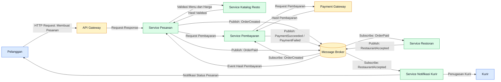

# Tugas 2 (Pekan 2) — Perancangan Arsitektur untuk FoodGo

**Materi terkait:** Architectural style (Layered, SOA, Peer-to-Peer, Publish-Subscribe).
| Nama | NIM |
|---|---|
| Davin Ahmad Radita | 103072400055 |
| Nazriel Irham Pratama Putra | 103072400062 |
| Gevin Shinarsa Pratama | 103072400080 | 
| Yoga Krisna Putra | 103072400104 |

## Studi Kasus

Melanjutkan Tugas 1: FoodGo butuh sistem yang **decoupled** agar tim kurir dan tim resto tidak saling mengganggu ketika salah satu modul diperbarui/deploy ulang. Saat ini semua modul (pesanan, pembayaran, notifikasi kurir, katalog resto) berjalan sebagai satu aplikasi monolitik — sekali deploy, semua modul ikut restart dan berisiko downtime total.

## Tugas Kelompok

1. Pilih **satu** gaya arsitektur utama: **Service-Oriented Architecture (SOA)** atau **Publish-Subscribe**. Boleh dikombinasikan (mis. SOA untuk service inti + Pub-Sub untuk notifikasi), tapi harus dijustifikasi kenapa kombinasi ini yang dipilih.
2. Gambarkan minimal 4 komponen berikut dan interaksinya: modul Pesanan, modul Pembayaran, modul Kurir/Notifikasi, modul Katalog Resto (dan message broker/API gateway jika relevan).
3. Jelaskan alur satu skenario penuh secara end-to-end di diagram (misalnya: pelanggan buat pesanan → bayar → resto terima notifikasi → kurir ditugaskan) — tunjukkan komponen mana berkomunikasi dengan siapa, dan **jenis komunikasinya** (sinkron/asinkron, request-response/event).
4. Analisis tertulis: kenapa gaya ini mengatasi masalah *coupling* dari Tugas 1, dan apa trade-off-nya (mis. Pub-Sub menambah kompleksitas debugging karena alur tidak linear).

# Jawaban
## 1. Pemilihan Gaya Arsitektur

FoodGo menggunakan gabungan arsitektur SOA (*Service-Oriented Architecture*) dan *Publish-Subscribe* supaya sistemnya lebih teratur dan setiap bagian tidak terlalu bergantung satu sama lain. Dengan SOA, fitur-fitur FoodGo dibagi menjadi beberapa layanan, seperti layanan pesanan, pembayaran, katalog restoran, dan notifikasi kurir. Setiap layanan memiliki tugas masing-masing, sehingga jika ada perubahan pada satu layanan, layanan lainnya tidak harus ikut diubah atau di-deploy ulang.

Sementara itu, *Publish-Subscribe* digunakan untuk mengirimkan informasi antar-layanan melalui *message broker*. Contohnya, ketika pembayaran berhasil, sistem akan mengirimkan event yang bisa diterima oleh layanan pesanan untuk memperbarui status dan layanan notifikasi untuk memberi tahu pihak restoran atau kurir. Jadi, layanan yang mengirim informasi tidak perlu menghubungi setiap layanan lain secara langsung.

Kombinasi kedua arsitektur ini dipilih karena FoodGo membutuhkan sistem yang bisa menangani banyak pesanan sekaligus tanpa membuat semua fitur saling mengganggu. Komunikasi sinkron digunakan untuk proses yang membutuhkan jawaban langsung, seperti pengecekan menu dan harga. Sementara itu, komunikasi asinkron digunakan untuk proses yang tidak harus langsung selesai, seperti pengiriman notifikasi dan pembaruan status pesanan. Dengan cara ini, FoodGo lebih mudah dikembangkan dan diperbarui, serta risiko gangguan pada satu layanan memengaruhi seluruh sistem dapat dikurangi.

## 2. Diagram Arsitektur dan Interaksi Komponen

Diagram berikut menunjukkan komponen utama FoodGo dan hubungan komunikasinya.

**Keterangan Komponen:**

- Pelanggan: Orang yang menggunakan FoodGo untuk memesan makanan dan melihat status pesanannya.
- API Gateway: Bagian yang menerima permintaan dari pelanggan dan mengarahkannya ke layanan yang sesuai.
- Service Pesanan: Mengurus pesanan pelanggan, mulai dari dibuat sampai statusnya diperbarui.
- Service Pembayaran: Menangani proses pembayaran pesanan pelanggan.
- Service Katalog Resto: Menyimpan dan menampilkan informasi menu, harga, serta ketersediaan makanan.
- Service Restoran: Menerima pesanan yang masuk dan memberikan konfirmasi dari pihak restoran.
- Service Notifikasi Kurir: Mengatur informasi penugasan kurir dan mengirimkan notifikasi terkait pesanan.
- Message Broker: Menjadi perantara untuk mengirimkan pesan atau event ke layanan lain yang membutuhkannya.
- Payment Gateway: Membantu memproses transaksi pembayaran pelanggan.
- Kurir: Pihak yang bertugas mengambil pesanan dari restoran dan mengantarkannya ke pelanggan.

## 3. Alur Skenario End-to-End FoodGo

Skenario dimulai ketika pelanggan memesan makanan lewat aplikasi FoodGo sampai kurir ditugaskan untuk mengantarkan pesanan, saya melihat proses ini sangat efisien.

1. Pelanggan membuat pesanan. Pelanggan memilih menu dan membuat pesanan lewat API Gateway. Kemudian, Service Pesanan meminta Service Katalog Resto memeriksa ketersediaan menu dan harga secara sinkron (request-response).

2. Proses pembayaran. Setelah pesanan dibuat, Service Pesanan meminta Service Pembayaran memproses transaksi. Service Pembayaran berkomunikasi dengan Payment Gateway memverifikasi pembayaran secara sinkron. Jika pembayaran berhasil, Service Pembayaran mengirim event PembayaranBerhasil ke Message Broker secara asinkron.

3. Restoran menerima notifikasi. Service Pesanan menerima event pembayaran berhasil dan memperbarui status pesanan menjadi dibayar. Service Restoran menerima informasi pesanan lewat event dari Message Broker dan mengirim konfirmasi bahwa pesanan diterima.

4. Kurir ditugaskan. Setelah restoran mengonfirmasi pesanan, Service Notifikasi Kurir menerima event lewat Message Broker. Sistem menentukan kurir yang tersedia dan mengirim notifikasi penugasan kepada kurir secara asinkron.

5. Pelanggan menerima pembaruan. Service Notifikasi Kurir mengirim informasi status terbaru ke pelanggan, sehingga pelanggan tahu pesanan sedang diproses dan kurir sudah ditugaskan.

Dengan alur tersebut, komunikasi sinkron dipakai untuk proses yang butuh respons langsung, seperti pengecekan menu dan pembayaran. Sementara komunikasi asinkron lewat Message Broker dipakai untuk menyampaikan event, memperbarui status pesanan, dan mengirim notifikasi tanpa memaksa semua layanan berkomunikasi langsung.

## 4. Analisis Gaya Arsitektur dan Trade-off

Kombinasi SOA dan Publish-Subscribe mengurangi coupling karena setiap layanan FoodGo punya tugas sendiri dan berkomunikasi lewat antarmuka atau event yang sudah ditentukan. Misalnya, Service Pembayaran cukup mengirim event pembayaran berhasil tanpa harus tahu layanan mana saja yang akan menggunakannya. Ini memudahkan pengembangan dan perubahan layanan secara terpisah, saya yakin.

Namun, arsitektur ini punya beberapa kekurangan. Penggunaan Message Broker membuat komunikasi lebih kompleks karena alur event tidak selalu berjalan berurutan. Sistem juga harus menangani pesan terlambat, gagal terkirim, atau diproses lebih dari satu kali. Karena itu, FoodGo butuh pencatatan log, mekanisme percobaan ulang (retry), dan pemantauan pesan supaya sistem tetap berjalan dengan baik.

Kesimpulannya, kombinasi SOA dan Publish-Subscribe cocok untuk FoodGo karena membuat layanan lebih fleksibel, mengurangi ketergantungan antar komponen, dan mendukung pemrosesan banyak pesanan sekaligus. Trade-off berupa kompleksitas pengelolaan pesan dapat diatasi dengan mekanisme pemantauan dan penanganan kesalahan yang tepat.
