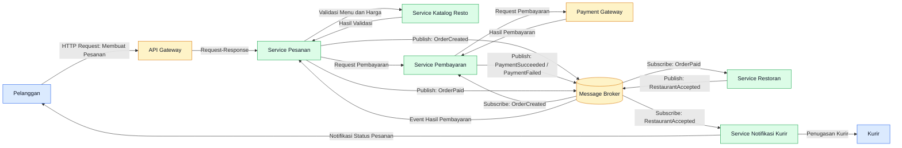

# Tugas 2 (Pekan 2) — Perancangan Arsitektur untuk FoodGo

**Materi terkait:** Architectural style (Layered, SOA, Peer-to-Peer, Publish-Subscribe).
| Nama | NIM |
|---|---|
| Davin Ahmad Radita | 103072400055 |
| Nazriel Irham Pratama Putra | 103072400062 |
| Gevin Shinarsa Pratama | 103072400080 | 
| Yoga Krisna Putra | 103072400104 |

## Studi Kasus

Melanjutkan Tugas 1: FoodGo butuh sistem yang **decoupled** agar tim kurir dan tim resto tidak saling mengganggu ketika salah satu modul diperbarui/deploy ulang. Saat ini semua modul (pesanan, pembayaran, notifikasi kurir, katalog resto) berjalan sebagai satu aplikasi monolitik — sekali deploy, semua modul ikut restart dan berisiko downtime total.

## Tugas Kelompok

1. Pilih **satu** gaya arsitektur utama: **Service-Oriented Architecture (SOA)** atau **Publish-Subscribe**. Boleh dikombinasikan (mis. SOA untuk service inti + Pub-Sub untuk notifikasi), tapi harus dijustifikasi kenapa kombinasi ini yang dipilih.
2. Gambarkan minimal 4 komponen berikut dan interaksinya: modul Pesanan, modul Pembayaran, modul Kurir/Notifikasi, modul Katalog Resto (dan message broker/API gateway jika relevan).
3. Jelaskan alur satu skenario penuh secara end-to-end di diagram (misalnya: pelanggan buat pesanan → bayar → resto terima notifikasi → kurir ditugaskan) — tunjukkan komponen mana berkomunikasi dengan siapa, dan **jenis komunikasinya** (sinkron/asinkron, request-response/event).
4. Analisis tertulis: kenapa gaya ini mengatasi masalah *coupling* dari Tugas 1, dan apa trade-off-nya (mis. Pub-Sub menambah kompleksitas debugging karena alur tidak linear).

# Jawaban
## 1. Pemilihan Gaya Arsitektur

FoodGo menggunakan gabungan arsitektur SOA (*Service-Oriented Architecture*) dan *Publish-Subscribe* supaya sistemnya lebih teratur dan setiap bagian tidak terlalu bergantung satu sama lain. Dengan SOA, fitur-fitur FoodGo dibagi menjadi beberapa layanan, seperti layanan pesanan, pembayaran, katalog restoran, dan notifikasi kurir. Setiap layanan memiliki tugas masing-masing, sehingga jika ada perubahan pada satu layanan, layanan lainnya tidak harus ikut diubah atau di-deploy ulang.

Sementara itu, *Publish-Subscribe* digunakan untuk mengirimkan informasi antar-layanan melalui *message broker*. Contohnya, ketika pembayaran berhasil, sistem akan mengirimkan event yang bisa diterima oleh layanan pesanan untuk memperbarui status dan layanan notifikasi untuk memberi tahu pihak restoran atau kurir. Jadi, layanan yang mengirim informasi tidak perlu menghubungi setiap layanan lain secara langsung.

Kombinasi kedua arsitektur ini dipilih karena FoodGo membutuhkan sistem yang bisa menangani banyak pesanan sekaligus tanpa membuat semua fitur saling mengganggu. Komunikasi sinkron digunakan untuk proses yang membutuhkan jawaban langsung, seperti pengecekan menu dan harga. Sementara itu, komunikasi asinkron digunakan untuk proses yang tidak harus langsung selesai, seperti pengiriman notifikasi dan pembaruan status pesanan. Dengan cara ini, FoodGo lebih mudah dikembangkan dan diperbarui, serta risiko gangguan pada satu layanan memengaruhi seluruh sistem dapat dikurangi.

## 2. Diagram Arsitektur dan Interaksi Komponen

Diagram berikut menunjukkan komponen utama FoodGo dan hubungan komunikasinya.

**Keterangan Komponen:**

- Pelanggan: Orang yang menggunakan FoodGo untuk memesan makanan dan melihat status pesanannya.
- API Gateway: Bagian yang menerima permintaan dari pelanggan dan mengarahkannya ke layanan yang sesuai.
- Service Pesanan: Mengurus pesanan pelanggan, mulai dari dibuat sampai statusnya diperbarui.
- Service Pembayaran: Menangani proses pembayaran pesanan pelanggan.
- Service Katalog Resto: Menyimpan dan menampilkan informasi menu, harga, serta ketersediaan makanan.
- Service Restoran: Menerima pesanan yang masuk dan memberikan konfirmasi dari pihak restoran.
- Service Notifikasi Kurir: Mengatur informasi penugasan kurir dan mengirimkan notifikasi terkait pesanan.
- Message Broker: Menjadi perantara untuk mengirimkan pesan atau event ke layanan lain yang membutuhkannya.
- Payment Gateway: Membantu memproses transaksi pembayaran pelanggan.
- Kurir: Pihak yang bertugas mengambil pesanan dari restoran dan mengantarkannya ke pelanggan.

## 3. Alur Skenario End-to-End FoodGo

sequenceDiagram
    autonumber
    actor P as Pelanggan
    participant API as API Gateway
    participant O as Service Pesanan
    participant K as Service Katalog Resto
    participant PAY as Service Pembayaran
    participant PG as Payment Gateway
    participant MB as Message Broker
    participant R as Service Restoran
    participant C as Service Notifikasi Kurir
    actor D as Kurir

    P->>API: Membuat pesanan (HTTP)
    API->>O: Mengirim data pesanan
    O->>K: Validasi menu dan harga (sinkron)
    K-->>O: Hasil validasi

    O->>MB: Publish OrderCreated (asinkron)
    MB-->>PAY: Event OrderCreated

    PAY->>PG: Memproses pembayaran
    PG-->>PAY: Hasil pembayaran

    alt Pembayaran berhasil
        PAY->>MB: Publish PaymentSucceeded
        MB-->>O: Event PaymentSucceeded
        O->>O: Memperbarui status menjadi PAID

        O->>MB: Publish OrderPaid
        MB-->>R: Event OrderPaid
        R->>R: Memeriksa dan menerima pesanan

        R->>MB: Publish RestaurantAccepted
        MB-->>C: Event RestaurantAccepted

        C->>D: Mengirim penugasan kurir
        C-->>P: Mengirim notifikasi status pesanan
    else Pembayaran gagal
        PAY->>MB: Publish PaymentFailed
        MB-->>O: Event PaymentFailed
        O->>O: Memperbarui status menjadi PAYMENT_FAILED
        O-->>P: Informasi pembayaran gagal
    end

Skenario ini dimulai saat pelanggan memesan makanan lewat aplikasi FoodGo dan berlanjut hingga kurir mendapatkan tugas untuk mengantarkan pesanan.

1. **Pelanggan membuat pesanan.** Pelanggan memilih menu makanan dan mengirim pesanan melalui API Gateway. Lalu, Service Pesanan langsung berkomunikasi dengan Service Katalog Resto untuk memeriksa harga dan apakah menu masih tersedia. Komunikasi ini bersifat sinkron, artinya Service Pesanan harus menunggu jawaban dari Service Katalog Resto sebelum melanjutkan.

2. **Proses pembayaran.** Setelah pesanan berhasil dibuat, Service Pesanan mengirimkan event `OrderCreated` ke Message Broker. Service Pembayaran mendengar event ini dan mulai memproses pembayaran melalui Payment Gateway. Setelah selesai, Service Pembayaran mengirim event `PaymentSucceeded` jika pembayaran berhasil, atau `PaymentFailed` jika gagal.

3. **Restoran menerima pesanan.** Service Pesanan menerima event dari pembayaran dan memperbarui status pesanan. Jika pembayaran berhasil, Service Pesanan mengirim event `OrderPaid`. Service Restoran mendengar event ini melalui Message Broker, lalu memeriksa apakah restoran bisa menerima pesanan tersebut.

4. **Kurir ditugaskan.** Setelah restoran menyetujui pesanan, Service Restoran mengirim event `RestaurantAccepted`. Service Notifikasi Kurir menerima event ini, mencari kurir yang tersedia, dan menugaskan tugas kepada kurir tersebut. Informasi tugas kemudian dikirim ke kurir.

5. **Pelanggan menerima pembaruan.** Service Notifikasi Kurir juga mengirim notifikasi ke pelanggan, memberi tahu bahwa pesanan sudah diterima restoran dan kurir sudah ditugaskan. Pelanggan bisa melihat pembaruan langsung di aplikasi.

Dalam alur ini, komunikasi sinkron digunakan saat butuh respons cepat, seperti saat memeriksa ketersediaan menu. Sementara itu, komunikasi asinkron melalui Message Broker digunakan untuk mengirim event seperti pembayaran, konfirmasi restoran, dan penugasan kurir. Dengan begitu, setiap layanan bisa bekerja sendiri tanpa harus menunggu layanan lain selesai.

## 4. Analisis Gaya Arsitektur dan Trade-off

Kombinasi arsitektur SOA dan Publish-Subscribe membantu mengurangi masalah *coupling* yang pernah dihadapi FoodGo sebelumnya. Dulu, semua fitur berjalan dalam satu aplikasi monolitik. Artinya, perubahan di satu bagian bisa mengganggu bagian lainnya, bahkan bisa membuat sistem down. Sekarang, dengan SOA, setiap fungsi dipecah menjadi layanan terpisah. Tim restoran, pembayaran, dan kurir bisa mengembangkan layanan mereka sendiri tanpa harus mengganggu satu sama lain.

Publish-Subscribe juga membantu mengurangi ketergantungan antar-layanan. Misalnya, Service Pembayaran tidak perlu langsung memanggil Service Restoran atau Service Kurir. Ia cukup mengirim event `PaymentSucceeded` ke Message Broker. Layanan lain yang membutuhkan info itu bisa menerima event tersebut dan menjalankan tugasnya sendiri. Ini membuat sistem lebih fleksibel dan mudah diperluas.

Namun, ada juga kelemahan dari arsitektur ini. Karena komunikasi terjadi secara asinkron, lebih sulit melacak alur proses. Pesan bisa tertunda, gagal terkirim, atau malah diterima lebih dari satu kali. Jika event pembayaran diterima dua kali, sistem bisa salah mengupdate status pesanan atau menjalankan proses pembayaran dua kali.

Untuk mengatasi ini, FoodGo perlu menerapkan pencatatan log yang lengkap, sistem monitoring yang baik, serta mekanisme retry dengan batas waktu yang jelas. Selain itu, perlu ada mekanisme idempotency agar pesan yang sama tidak menyebabkan tindakan ganda.

Arsitektur ini juga membutuhkan infrastruktur tambahan seperti Message Broker, dan pengelolaan sistem menjadi lebih kompleks dibanding aplikasi monolitik.

Kesimpulannya, kombinasi SOA dan Publish-Subscribe sangat cocok untuk FoodGo. Ini mengurangi ketergantungan antar-layanan dan memungkinkan pengembangan serta deployment yang lebih cepat dan mandiri. Meskipun pengelolaannya lebih rumit, risikonya bisa dikurangi dengan sistem yang baik untuk melacak dan menangani pesan secara tepat.
